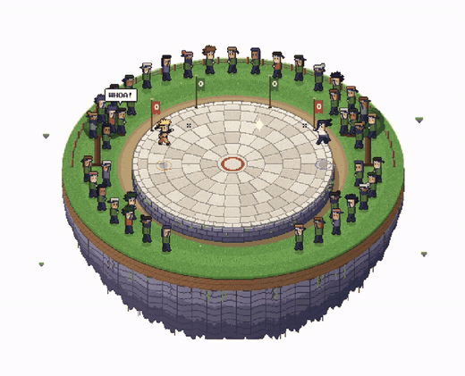
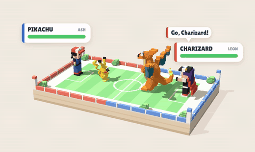
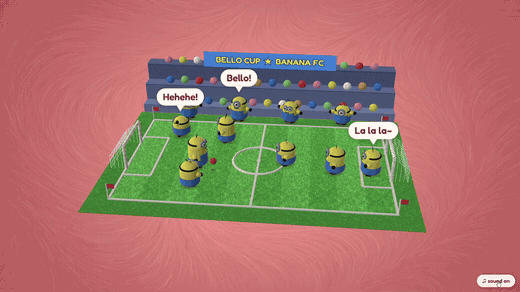
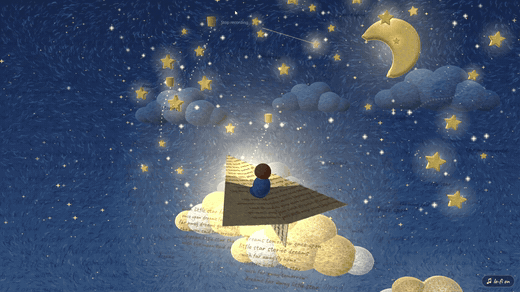
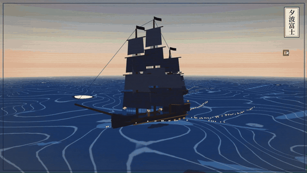
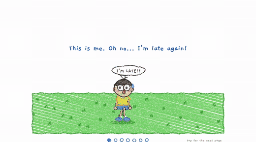
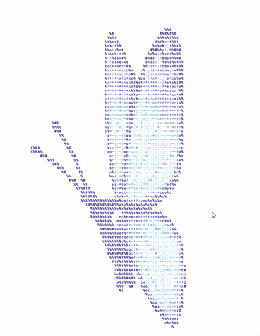

# Art Style Skills

6 Claude skills, one folder each. Each folder has a `SKILL.md` that tells Claude how to produce that style.

## See them in action
Every clip below was drawn entirely by code using these skills, with no images and no image models. Click a preview to watch the full video.

<table>
<tr>
<td align="center" width="50%"> <b>Pixel sprite art</b> Naruto vs Sasuke on a floating arena · <a href="media/pixel-sprite-art.mp4">▶ full video</a></td>
<td align="center" width="50%"> <b>Voxel art</b> A MagicaVoxel-style Pokémon battle · <a href="media/voxel-art.mp4">▶ full video</a></td>
</tr>
<tr>
<td align="center" width="50%"> <b>Needle felt</b> Felt minions playing football · <a href="media/needle-felt.mp4">▶ full video</a></td>
<td align="center" width="50%"> <b>Needle felt (storybook)</b> A paper-plane dream with lo-fi music · <a href="media/needle-felt-dream.mp4">▶ full video</a></td>
</tr>
<tr>
<td align="center" width="50%"> <b>Ukiyo-e</b> Tall ships sailing for Mt Fuji in 3D · <a href="media/ukiyo-e.mp4">▶ full video</a></td>
<td align="center" width="50%"> <b>Crayon kid drawing</b> A picture story that draws itself · <a href="media/crayon-kid-drawing.mp4">▶ full video</a></td>
</tr>
<tr>
<td align="center" width="50%"> <b>ASCII art</b> A watercolour butterfly made of text · <a href="media/ascii-art.mp4">▶ full video</a></td>
<td></td>
</tr>
</table>

| Folder | Style | Output |
|---|---|---|
| `pixel-sprite-art` | 16-bit chibi pixel characters and fight scenes | Sprites and scenes drawn by code (HTML/JS, a sprite engine and demo, plus a top-down rock-gym scene), or an image prompt |
| `voxel-art` | MagicaVoxel-style 3D made of little cubes | Built live by code (Three.js voxel engine with soft shadows, bloom and sound, plus an animated battle diorama example), or an image prompt |
| `needle-felt` | Fuzzy handmade wool figures | Built live by code (Three.js shell-fur felt engine with voices and quote bubbles, plus a felt football stadium and a storybook paper-plane scene), or an image prompt |
| `ukiyo-e` | Japanese woodblock print | Built live by code (an explorable 3D woodblock sea with tall ships, toon shaders, koto music and an auto camera film for recording), or an image prompt |
| `crayon-kid-drawing` | Wobbly child's crayon drawing | Drawn live by code (HTML canvas engine, with a running-friends picture and an animated picture story with music), or an image prompt |
| `ascii-art` | ASCII / Unicode block "terminal pixel art", plus animated colour ASCII | Text art drawn by Claude itself, a live colour-ASCII web renderer (with a butterfly example), or an image prompt |

## Building from a reference image
Every skill includes `references/reference-workflow.md`. When you give Claude a reference image, it first works out what you want out of it (match closely or just inspired, still or animated, auto-play for recording). It then writes a short brief of the image (camera, layers, an inventory with counts, palette, light), builds the scene in layers, and checks a screenshot side by side against the reference before showing you the result. The style comes from the skill; the content and the level of detail come from your reference. Each skill also has `references/style-checks.md`: the mistakes that came up for that style in real use, how to fix them, and a final checklist.

## How to install
Copy the folders you want into one of these:
- **One project only:** `<your-project>/.claude/skills/`
- **All your projects:** `C:\Users\<you>\.claude\skills\`

Each skill must stay in its own folder with the file named exactly `SKILL.md`. Copy the whole folder, including any `scripts/`, `references/` and `examples/` subfolders (`pixel-sprite-art`, `ascii-art`, `crayon-kid-drawing`, `voxel-art`, `needle-felt` and `ukiyo-e` use them). Claude picks a skill automatically when your request matches its description. You can also ask for one by name, e.g. "use the ukiyo-e skill".

## Same character, every style
Every image skill uses the same example character, so a set of images looks like a series:

> A girl with curly dark hair, yellow jacket and blue jeans, arms raised, jumping with a white fluffy dog.

Swap in your own character description, keep it word-for-word identical across styles, and add a reference image when the image tool supports one.
